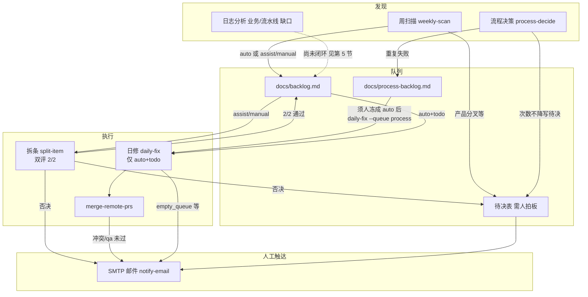

# 自制工程飞轮（Automation Harness）

> 目标：在契约已冻的前提下，尽量**离人自转**——发现缺口 → 进队列 → 能自动做的自动做 → 不能自动的先拆再做 → 卡住就通知人，避免静默停摆。  
> 调度真相源仍是 [`backlog.md`](backlog.md)；流程自身故障用 [`process-backlog.md`](process-backlog.md)。本页只描述全局设计与缺口，不写利用步骤。

---

## 1. 从「两环」到「飞轮」

原先只有两环：

| 环 | 脚本 | 作用 |
| --- | --- | --- |
| 日修 | `daily-fix-cron.sh` → `daily-fix.sh` | 领 `auto`+`todo`，实现、门禁、审核、开 PR |
| 周扫 | `weekly-scan-cron.sh` → `weekly-scan.sh` | 扫代码/文档漂移，往 backlog 补已冻或待决项 |

缺片时会发生：日修把 `auto` 做完 → 队列空 → cron 空转成功退出 → **人几天不看就停摆**；`assist`/`manual` 堆着却进不了日修。

现在补上的环：

| 环 | 脚本 | 作用 |
| --- | --- | --- |
| 合 PR / 清分支 | `merge-remote-prs.sh`、`prune-merged-branches.sh` | 日修前消化已绿 PR，避免「有 PR 就不新开」卡死 |
| 拆条 | `split-item.sh` | `assist`/`manual` 不能直接进日修时：拆 1 + 评 A/B，**双评 2/2** 才写成 `auto` |
| 流程飞轮 | `process-decide-cron.sh` → `process-decide.js` | 读 `logs/automation-runs.ndjson`，重复失败才改 `process-backlog.md` |
| 人工触达 | `lib/notify-email.sh` | 空队列、脏工作区、fetch/鉴权失败、拆条否决、门禁/审核反复失败等发邮件，避免静默 |

日修 cron 的顺序（摘要）：

```
fetch → main 快进
  → 合并远端日修/周扫 PR（合不了则今日停，并记原因/可发信）
  → 删已合并本地分支
  → 若无 auto+todo 且有 assist|manual+todo：split-item --yes（每天最多 1 条，只 commit）
  → daily-fix --yes --push（复用拆条分支 → 改名 auto-* → 一个 PR）
  → 若拆成功但日修失败：兜底仍推 auto-* PR，避免 empty_queue 死循环
```

---

## 2. 飞轮总览



---

## 3. 各环职责与边界

### 3.1 周扫描（补题）

- **做**：把能冻契约的缺口写成 `auto`+`todo`（单次有上限）；叫人的写入待决；可把能拆的父项标 `split` 并补子项。
- **不做**：擅自把未冻的 `assist`/`manual` 改成 `auto`；写利用步骤。
- **和拆条的分工**：周扫可以顺手拆；空队列时的**主动拆**由 `split-item` 承担，避免日修停摆。

### 3.2 拆条（assist/manual → 可日修）

详见 [`backlog.md`](backlog.md) 文首「自动拆条」。要点：

- 提案人（拆）**不计票**；评 A / 评 B **计票**；采用须 **2/2 PASS**。
- 评委只做五条二元清单（一次 PR / 契约不打架 / manual 壳分离 / 不误标 auto / 不重复抢范围）。
- 同一条目：主拆 1 + 最多改版 1；每轮双评；仍不过 → **不新增 auto**，可记待决并邮件 `split_rejected`。
- **commit 边界**：拆条单独一笔 `docs(backlog)`；与日修实现 **禁止 squash**。
- **PR 策略**：cron 用 `--yes`（不开 PR）。日修复用该分支改名为 `auto-fix|feat/<子项>-日期`，与日修变更打进**同一个**可被 `merge-remote-prs` 合并的 PR。不要为 `docs/split-*` 单独开 PR（合不进 → main 持续无 auto → `empty_queue` 循环）。
- 手动单独合入时仍可用 `--yes --push`。

### 3.3 日修（执行 auto）

- 只领 `auto`+`todo`（可 `--queue process` 读流程队列）。
- 阶段：登记 `test_cases` → 实现 → `qa-report` → 独立审核 → 回写 `done` → PR。
- 若当前已在领先 `main` 的拆条分支上：`git_sandbox_prepare_task_branch` 复用并改名，PR 基线仍为 `main`；日修 diff 起点为拆条 tip（审核看不到拆条 commit 里的 backlog 差分）。
- 前置依赖合 PR 脚本：有未合日修 PR 且不能自动合时，**今日不新开**，避免分叉爆炸。`--push` 时若远端已有开放的 `auto-fix/*` 或 `auto-feat/*`，日修直接拒绝，不再从同一版队列切开下一条。

### 3.5 队列表合并（2026-11-26 事故）

2026-11-25 四条日修 PR（S22–S25）从同一版 `docs/backlog.md` 切开，每条都把自己的一行改成 `done`。人在把 `main` 合进后一条分支时，冲突解决把已经完成的 S22 写回 `todo`，并让 S23、S24 各留下一行 `todo` 和一行 `done`。修订记录里的「S22 完成」还在。2026-11-26 10:00 的日修只读队列表，看到 S22 仍是优先级 10 的 `todo`，又开了 [PR #103](https://github.com/hanalice/bagujing/pull/103)。

规则：

- 同一 ID 在队列表只留一行。`done` / `split` 胜出 `todo`。
- 修订记录出现「ID 完成」而队列表仍是 `todo` 时，收回为 `done`。选单同样跳过这种 ID。
- 日修 cron 在选任务前跑 `reconcile-backlog.sh --commit`，有变化才提交并推 `main`。
- 自动合并时，多于一条日修 PR 仍全部留下。恰好一条且**只有** `docs/backlog.md` 冲突时，用两边的队列表和修订记录做上述收回，再合并。契约或其它文件有分歧则停，并按原路径通知人。
- 不要在 GitHub 上逐行手改这张表的状态。手改错了，下一轮 cron 仍会按完成记录收回，避免再修一次已完成的项。

### 3.4 流程飞轮（流水线自检）

- 输入：`logs/automation-runs.ndjson`（gitignore，不进库）。
- 同一原因在窗口内满阈值 → 追加 `process-backlog` 的 `assist` 或降优先级；次数不降 → 待决。
- `ok` / `empty_queue` / `already_running` 等不计为「要修流水线」。
- 流程项同样要冻契约后才能被日修执行（与业务队列同一套分级纪律）。

### 3.5 邮件通知（防静默）

- 配置：本机 `~/.config/bagujing/automation-notify.env` 或 `scripts/automation/automation-notify.env.local`（见 `automation-notify.env.example`，**勿提交密钥**）。
- 试发：`./scripts/automation/send-notify-test.sh`。
- 会发信的原因包括：`empty_queue`、`dirty_worktree`、`fetch_failed`、`pr_conflict` / `pr_unmerged`、`qa_failed`、`review_rejected`、`agent_auth`、`agent_unavailable`、`contract_missing`、`scan_rejected`、`split_rejected`、`secret_scan`、`commit_hook_failed`、`split_fallback_pr` / `split_fallback_failed`、`unknown`。
- 邮件正文带**动态** `taskId`（不写死 F11 等编号）、当天 cron 日志路径、尾部摘录；「请你做的事」只展开**本次 reason**，避免把通用 QA 手册误当成本次原因。
- 提交钩子失败（密钥扫描等）记 `secret_scan` / `commit_hook_failed`，与 `qa_failed` 区分；拆条兜底取号优先分支名 / `.last-daily-fix-task` / 拆条时冻结的首个 auto，避免写回 done 后串到下一条。
- **单测禁发真信**：`automation_record` 会触发通知；测码须 `AUTOMATION_NOTIFY_DISABLE=1`（见 UT-PROCESS-04），否则 pre-commit 跑单测会读本机 SMTP 误发夹具里的 `S14/qa_failed`。
- **不发**：成功、`already_running`、用户取消、dry-run。

---

## 4. 分级如何卡住 / 如何松开

```
发现缺口
  → 能冻且可无人值守？ → auto + todo → 日修
  → 还不能冻？ → assist + todo → 拆条（或人拆）→ auto 子项
  → 含运维壳？ → manual 父项 / 壳 → 拆出代码切片为 auto，壳留 manual
  → 产品分叉 / 破坏性默认？ → 待决 → 邮件或人看推荐 → 逾期可按推荐落盘
```

日修**永远不会**把 `assist`/`manual` 直接当任务做；松开的闸门是拆条 2/2 或人改分级。

---

## 5. 缺口：怎样才算「自己一直转」

下面按「缺了会停」排序。已有的标「已有」；未闭环的标「缺口」，便于下次拆条/周扫登记。

| # | 能力 | 状态 | 不补会怎样 | 建议下一刀 |
| --- | --- | --- | --- | --- |
| 1 | 日修执行 auto | 已有 | — | — |
| 2 | 周扫补 backlog | 已有 | auto 耗尽后无新题 | 保持周扫；空队列靠拆条续命 |
| 3 | 拆 assist/manual | 已有 | 日修空转 | 观察双评否决率，必要时收紧清单 |
| 4 | 合 PR / 清分支 | 已有 | 有 PR 就永远不新开；队列表冲突若手改会把 done 写回 todo | 多于一条日修 PR 不自动挑；仅 backlog 冲突按完成记录收回；其它冲突仍邮件 + 人 |
| 5 | 失败记 NDJSON + 流程队列 | 已有 | 流水线重复挂掉无人修 | 流程项仍须拆/人冻成 auto |
| 6 | 邮件防静默 | 已有 | 人几天不看才发现停摆 | 配好 SMTP；区分「要人」与「已自愈」 |
| 7 | **流水线日志分析 → 自动出题** | 已登记 **F1**（`assist`） | 只有计数阈值，没有「读日志摘要 → 冻契约」 | 拆条 2/2 后落地：读 `automation-runs.ndjson` + cron 日志，只写 `process-backlog` 的 assist/待决 |
| 8 | **业务审计 / 指标 → 调优先级或出题** | 已登记 **F2**（`assist`，S18 residual） | 线上 reason 飙升但 backlog 顺序不变 | 拆条 2/2 后落地：读 `ai_audit_logs`，只建议改优先级或开 assist；禁止盲改数字 |
| 9 | 脏工作区自愈 | 缺口 | 连续多日 `dirty_worktree` 拒跑 | 邮件已有；可加「检测是哪一分支/哪类文件」到信里；自动 stash 风险高，默认不做 |
| 10 | 鉴权 / fetch 自愈 | 缺口 | agent 或 gh 过期则整周停 | 邮件已有；文档写清续期步骤；不在仓库存长活 token |
| 11 | 待决逾期落盘 | 已有（周扫） | 待决堆积 | 保持 7 天规则；拆条否决进待决后靠人改口径 |
| 12 | 依赖漏洞月报 | 已有（独立工作流） | 与日修脱节 | 月报合入后**人**把要修的写进 backlog（扫描器不写队列） |
| 13 | 覆盖率门槛 E15/E16 | assist 等待数字 | 质量闸未合上 | E14 已出报告后，人确认 ≥60% 再改 auto（或拆条评估） |

**原则**：能自动的自动；不能自动的先拆；拆不过或要拍板的必须**触达人**。禁止为了「全自动」把未冻契约标成 `auto`——那会把飞轮变成无人值守踩坑机。

---

## 6. 日志与观测（现状 vs 目标）

| 来源 | 位置 | 谁读 | 现状 |
| --- | --- | --- | --- |
| 日修/周扫/拆条结局 | `logs/automation-runs.ndjson` | `process-decide` | 已有计数飞轮 |
| cron 全文 | `logs/daily-fix-cron-*.log` 等 | 人 / 未来分析环 | 已有落盘，无自动摘要出题 |
| QA 报告 | `docs/qa_report.md`（gitignore） | 人 / CI Artifact | 门禁用，不进队列 |
| 业务 AI 审计 | `ai_audit_logs` / NDJSON 审计文件 | 人 / 未来 reason 排行 | S18 已补字段；**按 reason 改 backlog 优先级**未做 |
| 业务 metrics | `GET /api/metrics`（可选令牌） | 运维 | 不自动写 backlog |

目标形态（未实现，仅设计）：

1. **流水线分析作业**（低频，如每日日修后）：聚类 `reason`、附最近日志摘录 → 只写 `process-backlog` 的 `assist` 或待决。  
2. **业务分析作业**（须审计窗口，如每日/每周）：按 `reason` 排行 → 输出「是否建议调整某业务项优先级」的提案（仍禁止盲改数字）。  
3. 两份分析都走与拆条相同的纪律：**不能直接变 auto**。

---

## 7. 相关入口

| 入口 | 路径 |
| --- | --- |
| 业务队列 | [`docs/backlog.md`](backlog.md) |
| 流程队列 | [`docs/process-backlog.md`](process-backlog.md) |
| 日修 | `scripts/automation/daily-fix.sh` |
| 拆条 | `scripts/automation/split-item.sh` |
| 周扫 | `scripts/automation/weekly-scan.sh` |
| 流程决策 | `scripts/automation/process-decide.js` |
| 邮件 | `scripts/automation/lib/notify-email.sh` |
| 裁决单测 | `backend/src/tests/split-review.test.js`（`UT-SPLIT-*`） |
| 流程单测 | `backend/src/tests/process-decide.test.js`（`UT-PROCESS-*`） |

---

## 8. 修订记录

| 日期 | 说明 |
| --- | --- |
| 2026-11-19 | 初版：两环升级为飞轮；写明拆条/通知/流程队列；列出日志分析等自转缺口 |
| 2026-11-19 | 缺口 #7/#8 登记为 backlog assist F1/F2（优先级 50/55） |
| 2026-11-26 | 事故：并发日修 PR 的人工合并把 S22 写回 todo，次日又开 PR #103。队列表改为 done 胜出 + 完成记录收回；多于一条日修 PR 不自动合并 |
