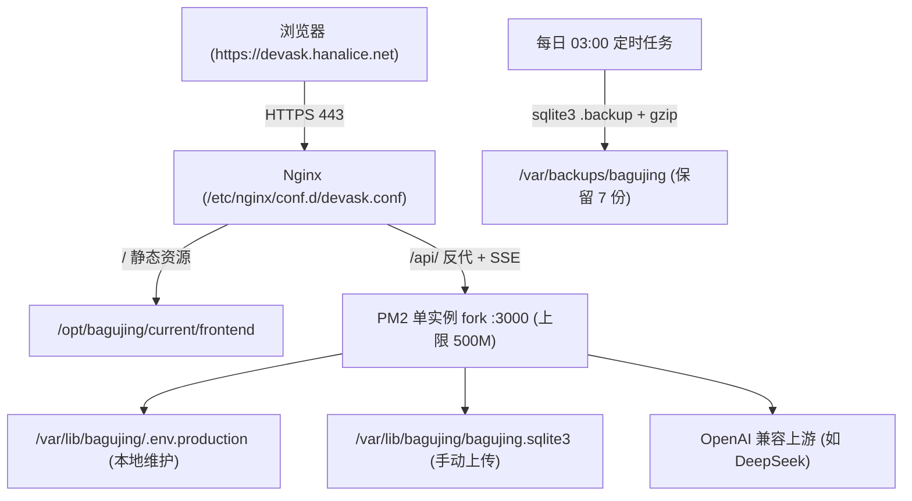

# DevAsk 阿里云 ECS 部署与运维手册（Alibaba Cloud Linux 3）

> 适用环境：阿里云 ECS **2核 2G / 40GB 存储 / Alibaba Cloud Linux 3.2104 LTS 64位**，支持同机多子域名项目隔离。
> 对外访问域名：`https://devask.hanalice.net`（内部代码目录代号仍为 `bagujing`）。
> 发布方式：**GitHub Actions 手动一键构建打包 → 非 root `deploy` 账号推送 → ECS 零编译原子切换**。

---

## 1. 架构与目录规划



### 目录权限与隔离规范

| 目录 | 属主与权限 | 用途 | 发版是否覆盖 |
| :--- | :--- | :--- | :---: |
| `/opt/bagujing/releases/<id>` | `deploy:deploy` (`755`) | 每次发布解压后的版本目录（自动保留最近 3 个） | 新增/清理旧版 |
| `/opt/bagujing/current` | `deploy:deploy` (软链) | 原子指向当前生效版本（Nginx 直接读 `current/frontend`） | 原子切换 |
| `/opt/bagujing/logs` | `deploy:deploy` (`755`) | PM2 与备份日志（已配 `pm2-logrotate`） | 保留 |
| `/opt/bagujing/incoming` | `deploy:deploy` (`755`) | GitHub Actions 上传发布包临时区（部署完自动清理） | 临时 |
| `/var/lib/bagujing/.env.production` | `deploy:deploy` (`600`) | 生产后端密钥与模型配置（ECS 本地维护） | **绝不覆盖** |
| `/var/lib/bagujing/bagujing.sqlite3` | `deploy:deploy` (`640`) | SQLite 生产数据库（含题库、用户与审计数据） | **绝不覆盖** |
| `/var/backups/bagujing/` | `deploy:deploy` (`750`) | 每日 03:00 压缩热备份（保留最近 7 份，约 50MB） | 保留 |
| `/etc/nginx/ssl/devask.hanalice.net/` | `root:root` (`700`) | 阿里云单域名证书 `fullchain.pem` + `privkey.key` | **绝不覆盖** |

---

## 2. 首次上线操作清单（按顺序执行）

### 第 1 步：阿里云安全组与 SSH 加固

1. 在阿里云 ECS 控制台 → 安全组 → 入方向仅放行 **`22`、`80`、`443`** 端口；**禁止放行 `3000`**。
2. 确认你自己已能通过 SSH 公钥登录 `root` 后，建议在 `/etc/ssh/sshd_config` 中关闭密码登录（`PasswordAuthentication no`）并执行 `systemctl reload sshd`，防止 22 端口被公网爆破。

### 第 2 步：在 ECS 执行首次初始化（仅需一次）

在本地将脚本与 Nginx 配置传到 ECS（或直接在 ECS 临时下载这 4 个文件）：

```bash
# 本地电脑执行：拷贝初始化所需脚本与 Nginx 模板到 ECS 临时目录
scp -r scripts/ecs-bootstrap.sh scripts/backup-sqlite.sh scripts/update-ssl-cert.sh deploy/nginx-ecs.conf deploy/nginx-default-reject.conf root@<ECS公网IP>:/tmp/bagujing-init/
```

登录 ECS 整理目录并执行初始化（`root`）：

```bash
ssh root@<ECS公网IP>
mkdir -p /tmp/bagujing-init/scripts /tmp/bagujing-init/deploy
mv /tmp/bagujing-init/*.sh /tmp/bagujing-init/scripts/
mv /tmp/bagujing-init/*.conf /tmp/bagujing-init/deploy/
bash /tmp/bagujing-init/scripts/ecs-bootstrap.sh
```

脚本会自动完成：
- 创建 **2GB Swap**；
- `dnf` 安装 Nginx / SQLite / cronie / logrotate / openssl（**不装编译工具链**）；
- 安装并 SHA256 校验 **Node.js 22 LTS** 与 **PM2**；
- 创建**无 `sudo` 权限**的 `deploy` 用户与最小权限目录；
- 生成 `/var/lib/bagujing/.env.production` 模板；
- 安装每日 03:00 SQLite 压缩热备份定时任务；
- 配置 Nginx 兜底拒绝规则与 `devask.conf`（证书未上传前暂存为 `devask.conf.pending`）。

### 第 3 步：生成专用部署 SSH 密钥并授权给 `deploy` 用户

在本地电脑单独生成一对部署密钥（不要复用个人登录 `root` 的主密钥）：

```bash
ssh-keygen -t ed25519 -f ./devask-ecs-deploy -N "" -C "github-actions-devask-ecs"
```

将公钥 `devask-ecs-deploy.pub` 的内容追加到 ECS 的 `/home/deploy/.ssh/authorized_keys`，并验证本地可直接免密登录 `deploy`：

```bash
ssh -i ./devask-ecs-deploy deploy@<ECS公网IP> "whoami && node -v && pm2 -v"
```

### 第 4 步：在 ECS 本地填写 `.env.production` 并上传初始 SQLite 题库

1. 在 ECS 上生成随机强密钥并编辑 `/var/lib/bagujing/.env.production`：

```bash
# 生成 3 组随机强密钥（分别用于 JWT_SECRET、AI_JWT_SECRET、AI_CLIENT_CREDENTIALS / VITE_AI_CLIENT_SECRET）
openssl rand -hex 32
openssl rand -hex 32
openssl rand -hex 32

vim /var/lib/bagujing/.env.production
```

关键核对项：
- 替换所有 `CHANGE_ME_*` 占位符（否则发版脚本会主动中止保护线上）；
- `OPENAI_BASE_URL` / `OPENAI_API_KEY`：国内 ECS 请使用国内可直连的 OpenAI 兼容服务（如 `https://api.deepseek.com`）；
- `AI_ALLOWED_ORIGINS=https://devask.hanalice.net`（末尾无斜杠）；
- `AI_CLIENT_CREDENTIALS=web:<密钥C>`（其中 `<密钥C>` 需与下面 GitHub Secret `VITE_AI_CLIENT_SECRET` 严格一致）。

2. 在本地确认 [backend/db/bagujing.dev.sqlite3](../backend/db/bagujing.dev.sqlite3) 已清理开发弱密码测试账号并保留强密码管理员账号后，手动上传到 ECS：

```bash
scp -i ./devask-ecs-deploy backend/db/bagujing.dev.sqlite3 deploy@<ECS公网IP>:/var/lib/bagujing/bagujing.sqlite3
ssh -i ./devask-ecs-deploy deploy@<ECS公网IP> "chmod 640 /var/lib/bagujing/bagujing.sqlite3"
```

### 第 5 步：配置 GitHub Repository Secrets（最小清单）

打开 GitHub 仓库 → **Settings → Secrets and variables → Actions → New repository secret**：

| Secret 名称 | 必填 | 示例 / 说明 |
| :--- | :---: | :--- |
| `ECS_HOST` | **是** | ECS 公网 IP（不要写进代码仓库） |
| `ECS_USER` | **是** | `deploy` |
| `ECS_SSH_KEY` | **是** | `./devask-ecs-deploy` 私钥全文（含 `BEGIN` / `END` 行） |
| `VITE_AI_CLIENT_SECRET` | **是** | 与 ECS `/var/lib/bagujing/.env.production` 中 `AI_CLIENT_CREDENTIALS` 的密钥段相同 |
| `ECS_PORT` | 否 | 默认 `22`（若改过 SSH 端口则填写） |
| `VITE_AI_CLIENT_ID` | 否 | 默认 `web` |
| `VITE_SENTRY_DSN` | 否 | 可留空 |

> 后端大模型密钥（`OPENAI_API_KEY`）、`JWT_SECRET`、`AI_JWT_SECRET` 均保留在 ECS 本地，**无需**配置到 GitHub Secrets。

### 第 6 步：手动一键部署（GitHub Actions）

1. 打开 GitHub 仓库 → **Actions → Deploy to Aliyun ECS (DevAsk) → Run workflow**。
2. 选择分支（通常为 `main`）：
   - 勾选 `dry_run` 可只打包并生成 Artifact 演练（不推 ECS）；
   - 保持 `dry_run = false` 点击 **Run workflow** 即可一键构建并零编译部署到 ECS。
3. 本机验证（备案审核通过前也可以直接在本机验活）：

```bash
ssh -i ./devask-ecs-deploy deploy@<ECS公网IP> "curl -fsS http://127.0.0.1:3000/api/health && echo && pm2 status"
```

---

## 3. 阿里云免费单域名证书安装与每 3 个月更新

备案审核通过后：
1. 在阿里云 DNS 解析为 `devask.hanalice.net` 添加 `A` 记录指向 ECS 公网 IP；
2. 在阿里云数字证书管理服务申请 `devask.hanalice.net` 的免费单域名证书，选择 **Nginx** 格式下载，解压得到 `.pem` 与 `.key` 两个文件；
3. 上传这两个文件到 ECS 并执行换证脚本（**首次执行会自动激活 `/etc/nginx/conf.d/devask.conf`**）：

```bash
scp devask.hanalice.net.pem devask.hanalice.net.key root@<ECS公网IP>:/tmp/
ssh root@<ECS公网IP> "bash /tmp/bagujing-init/scripts/update-ssl-cert.sh /tmp/devask.hanalice.net.pem /tmp/devask.hanalice.net.key devask.hanalice.net && rm -f /tmp/devask.hanalice.net.pem /tmp/devask.hanalice.net.key"
```

- 建议把 `scripts/update-ssl-cert.sh` 固定保留在 ECS 的 `/usr/local/sbin/update-ssl-cert.sh`（`chmod 700`），以后每 3 个月下载新证书后跑同一条命令即可；
- 脚本会自动校验证书与私钥匹配、备份旧证书、执行 `nginx -t`（失败自动回滚）并打印到期日期，建议在手机日历设置 **80 天循环提醒**。

---

## 4. 日常运维：秒级回滚与 SQLite 备份恢复

### 秒级回滚到上一个版本（`deploy` 用户）

`/opt/bagujing/releases/` 自动保留最近 3 个完整版本：

```bash
ls -lt /opt/bagujing/releases/
ln -sfn /opt/bagujing/releases/<目标版本号> /opt/bagujing/.current.tmp && mv -Tf /opt/bagujing/.current.tmp /opt/bagujing/current
pm2 restart /opt/bagujing/ecosystem.config.cjs --env production --update-env
curl -fsS http://127.0.0.1:3000/api/health
```

### 手动触发一次备份 / 从备份恢复

```bash
# 手动立即备份
/opt/bagujing/bin/backup-sqlite.sh
ls -lh /var/backups/bagujing/

# 从指定备份恢复（先停进程再恢复，避免 WAL 冲突）
pm2 stop bagujing-be-prod
rm -f /var/lib/bagujing/bagujing.sqlite3-wal /var/lib/bagujing/bagujing.sqlite3-shm
gunzip -c /var/backups/bagujing/bagujing-<日期>.sqlite3.gz > /var/lib/bagujing/bagujing.sqlite3
chmod 640 /var/lib/bagujing/bagujing.sqlite3
pm2 start /opt/bagujing/ecosystem.config.cjs --env production
```

---

## 5. 同机扩展后续其他子域名项目

以后在这台 ECS 上部署第二个项目（如 `app2.hanalice.net`）时，只需按同一隔离模板复用：
1. 程序目录：`/opt/<app2>/`（前端静态产物放 `/opt/<app2>/current/frontend`）；
2. 数据目录：`/var/lib/<app2>/`；
3. 本地端口：错开 `3000`（如 `127.0.0.1:3001`），PM2 进程名独立、单实例内存上限同样控制在 `400M~500M`；
4. SSL 证书：为 `app2.hanalice.net` 单独申请免费单域名证书，用 `update-ssl-cert.sh <pem> <key> app2.hanalice.net` 写入 `/etc/nginx/ssl/app2.hanalice.net/`；
5. Nginx 配置：复制 `/etc/nginx/conf.d/devask.conf` 为 `/etc/nginx/conf.d/<app2>.conf`，修改 `server_name`、证书路径、`root` 和 `proxy_pass` 端口后 `nginx -t && systemctl reload nginx`。
